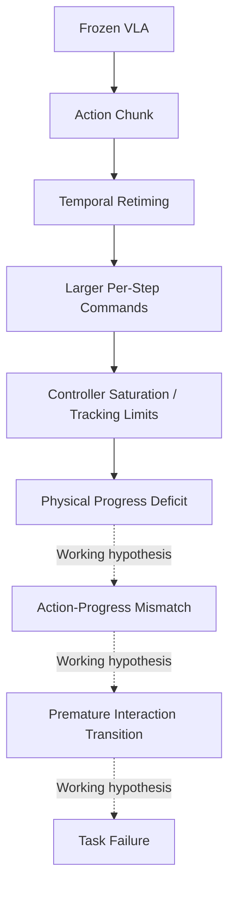

# Execution-Aware Retiming for Frozen Vision-Language-Action Policies

   

**How can frozen VLA policies be accelerated at deployment time without retraining while preserving long-horizon manipulation success?**

This is an ongoing research project, not a completed method or benchmark release. We are seeking research collaborators in robot execution, temporal planning, VLA evaluation, and failure analysis.

## Motivation

Action-chunk policies describe what a robot should do over a future horizon. Executing those chunks faster is not simply a matter of advancing a clock: commands must remain realizable by the controller, and physical interactions must occur in the right order. A geometrically reasonable compressed trajectory can still fail at a grasp, a contact transition, or a release.

We study the gap between **scheduled action progress and realized interaction progress**, with the policy weights frozen. Our objective is useful task-level acceleration, not merely fewer commands or shorter failed episodes.

## Problem formulation

Let a frozen policy produce a chunk $A=(a_0,\ldots,a_{H-1})$. A retimer with acceleration factor $\rho>1$ advances through the chunk using a source coordinate $\phi(t)$ faster than the reference execution. For compatible incremental translation commands, retiming can combine increments over a source interval into a larger command. This formulation does not automatically extend to rotations, absolute targets, or gripper signals; each requires explicit semantics.

A controller then maps the retimed command into physical motion under bounded inputs, tracking limits, and contact dynamics. Preserving a cumulative reference path before execution does **not** establish that the robot follows that path after execution. We ask which constraints explain failure, and what information a retimer needs to respect them.

## Current observation

The project investigates failures under aggressive post-hoc temporal compression. Failure videos motivate a mechanism-oriented study, but this repository does not yet provide a validated public result set. We do not infer a dominant cause from an unsuccessful rollout alone.

## Working hypothesis

Scheduled progress may advance faster than realizable physical progress. Near grasp, lift, alignment, contact, placement, and release, a subsequent action may then begin before its physical prerequisite has been achieved. Controller saturation and tracking limits are candidate contributors, not established explanations.

The diagram is a conceptual candidate mechanism, not a demonstrated causal chain. Even its solid execution-side links require measurement in the selected controller and action representation.

## What is confirmed vs. under investigation

| Category | Current position |
| --- | --- |
| Project design | Frozen-policy deployment-time retiming; matched comparisons; execution-side diagnostics. |
| Mathematical property | Summing compatible increments can preserve a reference endpoint before clipping; it does not guarantee physical equivalence. |
| Under investigation | Whether clipping, tracking, or interaction timing produces a progress deficit in the measured failures. |
| Not established | A dominant causal mechanism, a finalized retiming method, or a validated speed–success improvement. |

## Current matched-rollout diagnostic study

Compare RT-1.0 and accelerated execution using the same task, initial state, policy checkpoint, and controlled random seeds. Record synchronized videos, end-effector trajectories, source action chunks, retimed commands, effective clipped commands, and relevant interaction events. Identify the first divergence rather than diagnosing only the final failure.

No policy retraining or controller modification is introduced during this mechanism study. Details and confounds are documented in [the experimental protocol](docs/experimental_protocol.md).

## Failure phenotype taxonomy

| Phenotype | Diagnostic question |
| --- | --- |
| Displacement under-realization | Was the intended motion actually achieved? |
| Tracking lag or overshoot | Did the robot follow the commanded reference in time and space? |
| Contact / grasp failure | Did the interaction state differ before the next transition? |
| Gripper timing mismatch | Did closure or release occur at an unsuitable physical state? |
| Policy distribution shift | Did acceleration change observations and subsequent policy outputs? |
| Replanning instability | Did chunk refresh introduce discontinuity or inconsistency? |
| Timeout / efficiency failure | Did apparent speed reduce useful progress or consume the episode budget? |

These labels describe observable failure patterns; they are not mutually exclusive causal explanations.

## Method direction

A possible next direction is execution-aware or progress-aware retiming: advancing the action clock according to realizable motion and interaction readiness rather than a fixed compression ratio alone. Candidate signals include tracking residuals, command saturation, and task-relevant progress indicators. Their usefulness, reliability, overhead, and policy independence remain open questions.

## Project evolution

The project began with dynamic-k / action-chunk commitment gating. Its central question has shifted from choosing a commitment length to understanding what prevents accelerated chunks from being executed faithfully. Dynamic-k scheduling remains contextual background, not the claimed current contribution.

## Experimental platforms

The intended diagnostic setting uses frozen VLA policies, including π0.5, in LIBERO long-horizon manipulation and LIBERO-PRO variants where applicable. Task definitions, environment versions, checkpoint identity, and action semantics must be pinned before comparison. Separate ACT/DP experiments in RoboBase / BiGym are not evidence for this VLA retiming hypothesis and are not mixed into this project narrative.

## Current status

- [x] Research question and competing explanations articulated.
- [x] Public diagnostic protocol and staged roadmap documented.
- [ ] Matched rollout evidence validated and curated for release.
- [ ] Candidate mechanisms tested against alternative explanations.
- [ ] Execution-aware method finalized and ablated.
- [ ] Reproducible implementation and public evaluation released.

## Research roadmap

1. Characterize accelerated execution and locate first divergences.
2. Identify mechanisms using matched diagnostics and controlled interventions.
3. Develop execution-aware acceleration once evidence supports its design.
4. Evaluate long-horizon robustness and cross-policy generalization.

See [the roadmap](docs/roadmap.md) and [technical research notes](docs/research_notes.md).

## Preliminary findings

Our current interpretation is that action-space compression and physical execution should be evaluated separately. Interaction transitions provide useful places to look for disagreement. These are research motivations and provisional interpretations, not numerical results or a proven mechanism. No success-rate or acceleration claim is made here.

## Research status and disclaimer

This repository is a research showcase under active development. Hypotheses, protocols, and method directions may change as evidence accumulates. Raw experimental data and checkpoints are not published here. Implementation will be released progressively after validation; there is currently no end-to-end runnable release.

## Acknowledgements

We acknowledge the upstream VLA, simulation, and benchmark projects on which the intended experiments depend. Attribution and version-specific references will accompany released artifacts. This project is independent and does not imply endorsement by upstream maintainers.

## Collaboration and contact

**The project is ongoing, and we welcome research collaborators.** We are particularly interested in collaborators working on controller-aware execution, manipulation contact dynamics, temporal abstraction, matched-rollout instrumentation, and long-horizon evaluation.

Please open a [GitHub issue](https://github.com/2275861195-max/execution-aware-retiming/issues) with your research interests or a focused technical question. A dedicated project contact will be added later. Collaboration roles and authorship will be discussed explicitly; this page makes no commitments on either.
