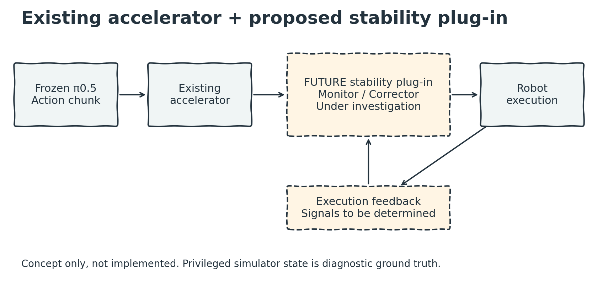
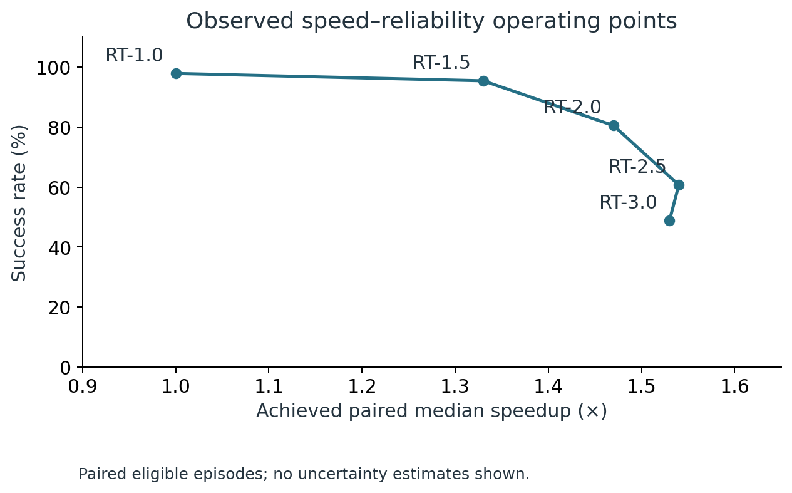
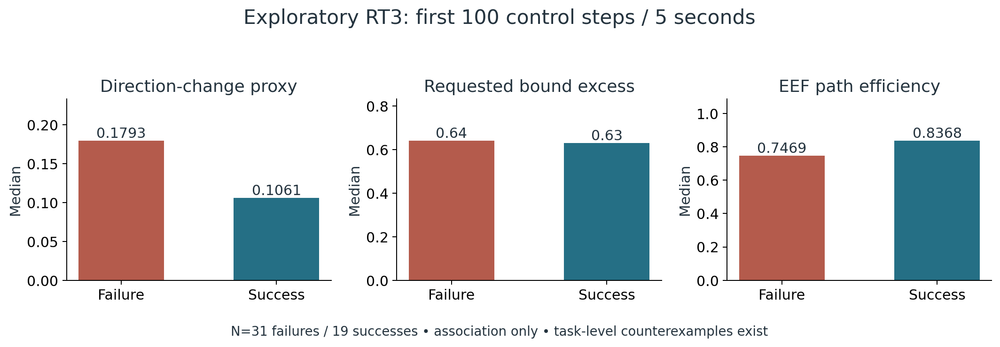
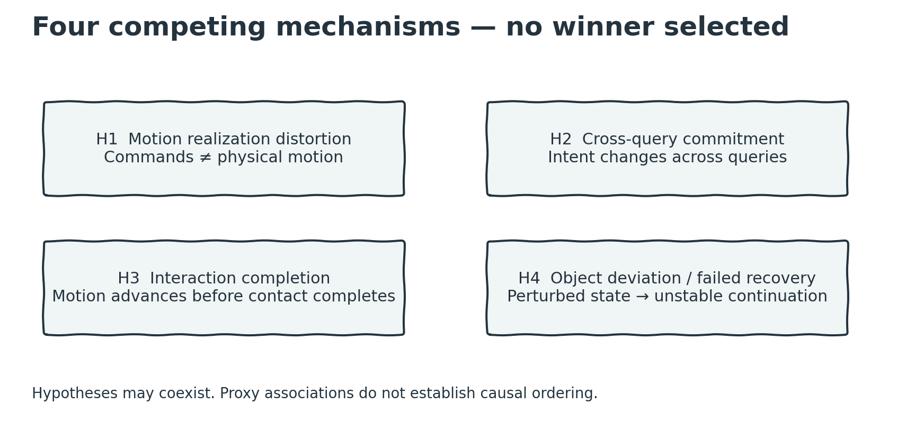
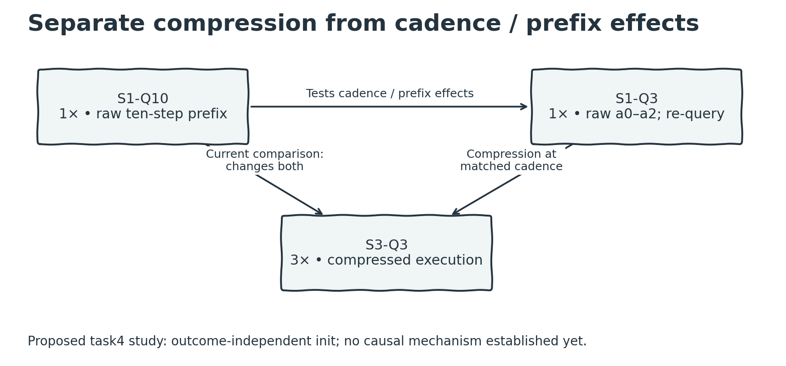

# Towards Stable Temporal Acceleration of Frozen Action-Chunk Policies

**Can frozen action-chunk policies execute faster at deployment time without losing reliability?**

We study post-hoc temporal acceleration and the execution failures that accompany it. Current empirical evidence comes from a frozen π0.5 policy. The aim is a lightweight post-acceleration stability layer that preserves useful speed gains without policy retraining.

> **Current stage: mechanism identification.** The stability plug-in is a research target, not yet an implemented or validated method. This is an ongoing independent research project, and we welcome collaborators.

Solid blocks describe the execution pipeline; the dashed plug-in is proposed. Its monitor, corrector and deployment signals remain under investigation. The existing accelerator is not necessarily our contribution.

## Observed speed–reliability tradeoff

| Setting | Success | Mean completion time¹ | Paired median speedup² | Mean policy calls¹ |
|---|---:|---:|---:|---:|
| RT-1.0 | 97.90% | 7.43 s | 1.00× | 15.29 |
| RT-1.5 | 95.45% | 5.76 s | 1.33× | 19.61 |
| RT-2.0 | 80.50% | 5.57 s | 1.47× | 22.71 |
| RT-2.5 | 60.70% | 5.73 s | 1.54× | 29.04 |
| RT-3.0 | 48.85% | 5.55 s | 1.53× | 37.34 |

¹ Successful episodes only. ² Eligible paired episodes; the exact pairing rule and denominator must accompany an episode-level release. No uncertainty estimates are shown. Requested acceleration is not achieved speedup.

From requested 2× to 3×, success falls **80.50% → 48.85%**, while paired median speedup increases only **1.47× → 1.53×**. These are the author-supplied verified overall aggregates, transcribed into [CSV](data/aggregated/overall_tradeoff.csv), not a new private-data audit. The older suite-level table is excluded.

## What we know — and do not know

Exploratory RT3 diagnostics compare **31 failures and 19 successes**, using the first **100 control steps / 5 seconds**. Direction change and EEF path efficiency show aggregate associations; requested bound excess is similar between groups. **Task-level counterexamples reverse both associations.** None is a validated universal instability signal, and causal ordering is unknown.

The selected diagnostic tasks are not population-representative. Missing object, contact and predicate state limits interpretation. See [evidence and limitations](docs/current_evidence.md).

## Four competing explanations

H1 motion realization distortion; H2 cross-query commitment instability; H3 interaction completion mismatch; H4 object-state deviation and failed recovery. No winner is selected, and multiple mechanisms may coexist.

## The critical confound and next experiment

Current RT1 uses speed 1× and queries every **10** steps; RT3 uses speed 3× and queries every **3** steps. Existing comparisons therefore change compression **and** query cadence together.

The proposed S1-Q3 control executes raw a0–a2 without retiming. S1-Q10 → S1-Q3 tests cadence/prefix-execution effects, not query frequency alone. S1-Q3 → S3-Q3 tests compression at matched cadence. These are controlled protocol comparisons, not proof of a mechanism.

Task4 is chosen for its proxy counterexample. The meeting plan proposes 20 outcome-independent initial states × 3 conditions, with optional Q3 repeats. New synchronized logging will connect policy actions, controller goals, robot motion, object/contact state and task predicates. Privileged simulator state is diagnostic ground truth, not an assumed deployable input. [Full next-experiment plan](docs/next_experiments.md).

## Future direction

A mechanism-dependent **Monitor / Corrector** could make minimal execution corrections after acceleration. Feasibility handling, commitment filtering, completion-aware execution and conservative recovery are examples to test—not implemented algorithms. Policy independence, ACT/DP generalization and canonical BiGym compatibility remain open goals.

## Explore the project

- [Research question](docs/research_question.md) · [Current evidence](docs/current_evidence.md)
- [Experimental protocol](docs/experimental_protocol.md) · [Next experiments](docs/next_experiments.md)
- [Aggregate summaries](data/aggregated/) · [Figures and editable draw.io sources](figures/)
- [Meeting materials — 13 October 2026](meeting/2026-10-13/)
- [Earlier research notes](docs/research_notes.md) · [Earlier roadmap](docs/roadmap.md)

Raw videos, checkpoints and private experiment files are not published. There is no end-to-end validated method release yet. Earlier notes are historical context; the current competing-hypothesis plan supersedes any narrower interpretation.

## Seeking research collaborators

We welcome collaborators interested in robot execution, manipulation dynamics, controlled experiments, failure-video analysis and policy generalization. Please [open an issue](https://github.com/2275861195-max/execution-aware-retiming/issues) with your interests or a technical question. Collaboration roles and authorship will be discussed explicitly.

We acknowledge upstream policy and simulation projects; this repository does not imply their endorsement.
